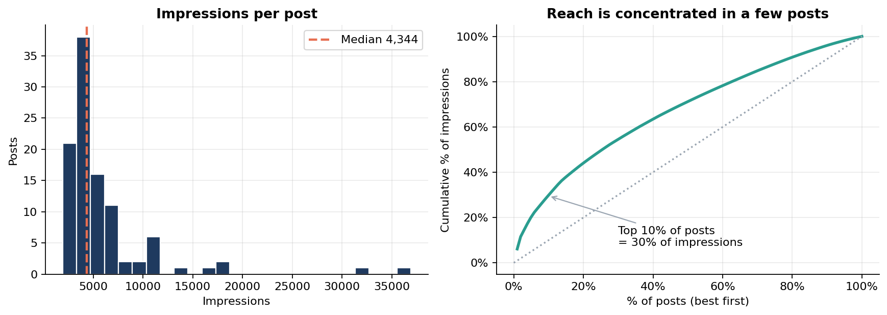

# Social Media Engagement Analysis (Instagram)

**Python · pandas · Matplotlib · seaborn · SciPy**

An end-to-end analysis of real Instagram post insights for a data-science education account: cleaning the raw export, engineering engagement metrics, and finding which **content types** and **traffic sources** drive reach, engagement and follower growth.



## Business questions
1. How much exposure do posts get, and how evenly is it spread?
2. Where does it come from: followers (Home), Hashtags or Explore?
3. How engaged is the audience, and in what way?
4. Which topics, hashtag counts, caption lengths and calls-to-action perform best?
5. How well does exposure convert into profile visits and new followers?

## Dataset
| | |
|---|---|
| File | `data/raw/instagram_data.csv` (119 rows, 13 columns) |
| Content | Per-post impressions (and split by Home / Hashtags / Explore / Other), likes, comments, shares, saves, profile visits, follows, caption, hashtags |
| After cleaning | **102 unique posts** (17 exact duplicates removed) |
| Source | Public Instagram-insights dataset obtained from the GitHub repo `Vaishnavishenvi/Instagram-Reach-Analysis`; the same data circulates as a Kaggle "Instagram reach" dataset. **Verify the original author/licence and credit them before publishing.** |

## Method
1. **Cleaning** (`src/prepare.py`): fix Windows-1252 encoding, standardise column names, remove duplicates, check missing values, reconcile traffic sources against impressions.
2. **Feature engineering**: engagement / save / share / profile-visit / follow rates, traffic-source shares, hashtag count, caption length, "link in bio" flag, keyword-rule **topic** classification, top-10% "breakout" flag.
3. **Analysis**: distributions and concentration, source mix, engagement composition, topic comparison, hashtag and caption effects, CTA effect, conversion funnel.
4. **Statistics**: Spearman correlations, Kruskal-Wallis (topics), Mann-Whitney U (CTA vs no CTA), used because the data are small and heavily skewed.

## Key findings
- **Reach is concentrated.** The median post gets ~4.3K impressions, but the top 10 posts (~10%) generate **~30%** of all impressions.
- **Breakouts are driven by Explore.** Top-10% posts get a median **~39%** of impressions from Explore vs **~8%** for others, and bring **~12x** the follows (94 vs 8).
- **Audience saves, it doesn't discuss.** Saves are **45%** of interactions (likes 51%); shares and comments combined are about 4.5%. Median engagement rate is **6.2%**.
- **Topic matters.** Project-idea posts get the most reach; career-resource posts the highest engagement rate (**7.3%**); ML/deep-learning posts the lowest engagement (4.3%) but the highest profile-visit rate (1.0%).
- **More hashtags did not mean more reach.** Hashtag count vs impressions: rho = **-0.45**; 21+ hashtags had the lowest median impressions.
- **Shorter captions engage and save more** (rho about -0.25) with no effect on reach.
- **"Link in bio" posts** get ~2x the reach, ~3.5x the profile-visit rate and ~7x the follows, with a lower engagement rate (4.2% vs 6.7%).
- **Funnel:** 0.92% of impressions become profile visits; **41.8%** of visits become follows.

See the notebook for charts, tests and the full recommendations table.

## Repository structure
```
├── data/
│   ├── raw/instagram_data.csv
│   └── processed/instagram_clean.csv
├── images/                      # exported charts
├── notebooks/01_instagram_engagement_analysis.ipynb
├── src/
│   ├── prepare.py               # cleaning + feature engineering
│   └── visualize.py             # all figures
├── requirements.txt
└── README.md
```

## Reproduce
```bash
pip install -r requirements.txt
python src/prepare.py        # writes data/processed/instagram_clean.csv
python src/visualize.py      # writes images/*.png
jupyter notebook notebooks/01_instagram_engagement_analysis.ipynb
```

## Limitations
- One account and 102 unique posts: findings describe this account, not Instagram generally; topic groups with n < 12 are directional.
- No post dates, so no time-of-day or trend analysis.
- No unique-accounts *Reach* column: **impressions** are the exposure measure.
- Associations, not causal effects (e.g. promotional posts also carry the CTA).
- Topics are assigned by keyword rules; borderline captions could be labelled differently.
- Traffic-source columns do not sum exactly to impressions; source shares use the sum of the source columns.
